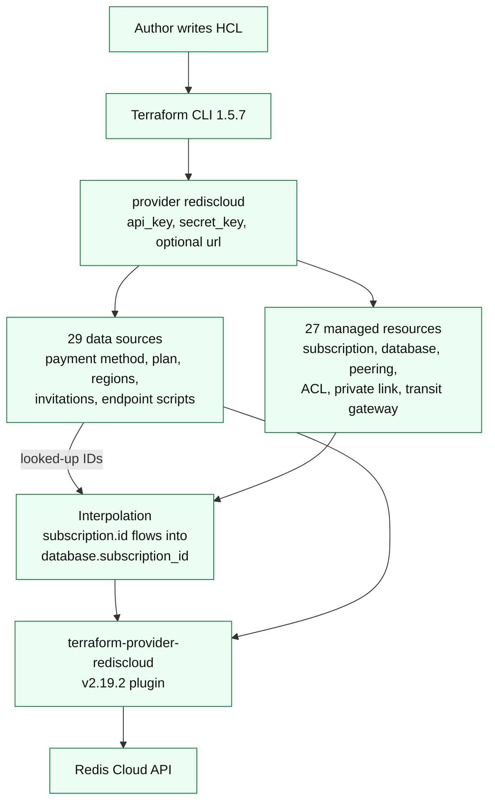
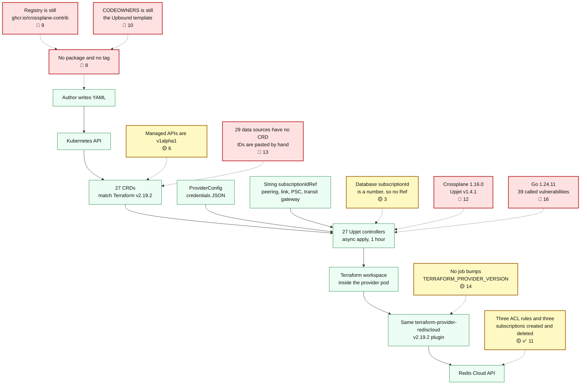

# Gap analysis: Crossplane provider to GA, against Terraform provider v2.19.2

Date: 21 October 2026.
Branch checked: `spike/tf-2.19.2-generate` (local, not pushed).
Terraform provider compared: `RedisLabs/terraform-provider-rediscloud` v2.19.2.
Crossplane generator: Upjet v1.4.1, schema taken from `terraform providers schema -json` for that Terraform provider.

This is the gap between the Crossplane provider and a GA provider that tracks the Terraform provider. It is not a proposal to build a native provider, and it does not cover Ultra.

Numbering and the architecture diagrams were added on 22 October 2026. The evidence dates stay 21 October 2026. Gap numbers run through both gap tables. `1` through `7` are the runtime findings. `8` through `17` are what remains before GA.

## Index

### Sections

- [Architectures](#architectures)
- [Result](#result)
- [Resource map](#resource-map)
- [Data sources](#data-sources)
- [What was run](#what-was-run)
- [Runtime gaps the resource count hides](#runtime-gaps-the-resource-count-hides)
- [Gaps that remain before GA](#gaps-that-remain-before-ga)
- [What this branch already removes from the gap](#what-this-branch-already-removes-from-the-gap)
- [What not to treat as a gap](#what-not-to-treat-as-a-gap)
- [What was checked for a public repository](#what-was-checked-for-a-public-repository)
- [Smallest path from this branch to a preview](#smallest-path-from-this-branch-to-a-preview)

### Gaps

**severity:** 🔴 is high, 🟡 is medium, and 🟣 is minor. **where:** is Runtime or Before GA. The index has two columns, Gap and Status. **Fix status:** is ✅, partial, or open. A fix explanation is labeled **Fix detail**. **Left unfixed** and **Plan** are their own bullets. A plan starts with **Fix** or **No fix**.

| Gap | Status |
| --- | --- |
| 1. Hand-written examples do not match the CRDs **severity:** 🟣 **Fix status:** ✅ **where:** Runtime | ✅ Fixed • **Fix detail:** The checker rejects unknown `forProvider` fields. 13 of 13 examples pass. |
| 2. Controller deadline is 3 minutes **severity:** 🟣 **Fix status:** ✅ **where:** Runtime | ✅ Fixed • **Fix detail:** Reconciler timeout raised from 3m to 30m across all 27 controllers after a live create was canceled at 180s. |
| 3. No cross-resource references **severity:** 🟡 **Fix status:** partial **where:** Runtime | Open for databases • **Fix detail:** String children have `subscriptionIdRef`. • **Left unfixed:** for databases because `subscription_id` is a number and Crossplane references only write strings. • **Plan:** No fix. Crossplane can write only a string into a reference, and the database subscription id is a number, so a database keeps copying `status.atProvider.id` by hand. That is not a planned code fix. |
| 4. Connection secret does not publish the endpoint **severity:** 🟡 **Fix status:** partial **where:** Runtime | ✅ Fixed for endpoint and port • **Fix detail:** `databaseConnectionDetails` publishes `public_endpoint`, `private_endpoint`, and `port`. • **Left unfixed:** for a provider-generated password because the sensitive-field mapping already owns that key. • **Plan:** No fix. The password already belongs to the sensitive-field mapping, so this provider will not write it a second time. |
| 5. One bad generated type **severity:** 🟡 **Fix status:** ✅ **where:** Runtime | ✅ Fixed • **Fix detail:** `initProvider.clientTlsCertificatesSecretRef` is a secret-reference list. |
| 6. Managed APIs are `v1alpha1` **severity:** 🟡 **Fix status:** open **where:** Runtime | Open • The README says the managed APIs are `v1alpha1`. • **Left unfixed:** because a v1 promotion would freeze the API before a published package and a supported Crossplane line. • **Plan:** No fix for a preview. Promote the managed APIs to v1 only when the package is published. |
| 7. Credentials secret shape is undocumented **severity:** 🟣 **Fix status:** ✅ **where:** Runtime | ✅ Fixed • **Fix detail:** The README documents the JSON keys `api_key`, `secret_key`, and optional `url`. |
| 8. Nothing is published **severity:** 🔴 **Fix status:** open **where:** Before GA | Open • GitHub releases: 0. Tags: 0. The README no longer installs a missing `v0.1.0` package. • **Left unfixed:** because a release needs a push and a tag, this work stayed local, and there is no Redis package registry. • **Plan:** Fix: publish a tag to a Redis registry once that registry exists. |
| 9. Publish pipeline is still Upbound's **severity:** 🔴 **Fix status:** open **where:** Before GA | Open • Workflows still target `ghcr.io/crossplane-contrib` and Upbound CI. • **Left unfixed:** because pointing them at a Redis registry would invent a registry name. • **Plan:** Fix: point the image registry at Redis and stop calling the Upbound publish workflows. |
| 10. No Redis owners **severity:** 🔴 **Fix status:** open **where:** Before GA | Open • `CODEOWNERS` and `OWNERS.md` still name the Upbound template maintainers. • **Left unfixed:** because the Terraform provider repo has no `CODEOWNERS` to copy, and inventing Redis owners would be worse. • **Plan:** Fix: replace `CODEOWNERS` and `OWNERS.md` after the Terraform provider team names the owners. |
| 11. No proof of a real apply **severity:** 🟡 **Fix status:** ✅ **where:** Before GA | ✅ Fixed • **Fix detail:** ACL rules, Pro subscriptions, and one Database CR were created, became Ready, and were deleted. Database 52440094 on subscription 10207968 copied the numeric subscription id, reached Cloud `active` and Kubernetes Ready, then both returned 404. |
| 12. Crossplane line is old **severity:** 🔴 **Fix status:** open **where:** Before GA | Open • Generation is Crossplane 1.16.0 and Upjet v1.4.1. The same build reconciled on a cluster running Crossplane 2.4.2. • **Left unfixed:** because preview has not named the Crossplane version it will support, and bumping the line is a regeneration. • **Plan:** Fix: name the Crossplane version this preview supports, then bump Upjet and crossplane-runtime if that version is not 1.16. |
| 13. Data-source lookups are manual **severity:** 🔴 **Fix status:** open **where:** Before GA | Open • 29 Terraform data sources have no CRD. Callers paste IDs. String subscription references exist. • **Left unfixed:** because Upjet does not turn data sources into CRDs, and 29 lookup resources would be a new API. • **Plan:** Fix: the payment method, plan, and region lookups. No fix for the other data sources. Callers keep pasting those IDs. |
| 14. Provider will go stale again **severity:** 🟡 **Fix status:** open **where:** Before GA | Open until the first preview • No job bumps `TERRAFORM_PROVIDER_VERSION`. • **Left unfixed:** because that job belongs with a Redis publish workflow, which is still Upbound's (gap 9). • **Plan:** Fix: add a job that bumps `TERRAFORM_PROVIDER_VERSION` after the Redis publish workflow exists. |
| 15. Go module path differs from the repo name **severity:** 🟣 **Fix status:** open **where:** Before GA | Open • The module is `github.com/RedisLabs/provider-rediscloud`. The repo is `crossplane-provider-rediscloud`. It does not block a preview. • **Left unfixed:** because renaming the module has to happen in the same commit as a regeneration. • **Plan:** No fix required for a preview. The documented module path stays. A rename happens only in the same commit as a regeneration. |
| 16. Known vulnerable dependencies **severity:** 🔴 **Fix status:** open **where:** Before GA | Open • `govulncheck` reported 39 called vulnerabilities on Go 1.24.11. • **Left unfixed:** because the patched modules need Go 1.25 or Go 1.26, and the CI pin is Go 1.24. Those bumps do not compile on Go 1.24. • **Plan:** Fix: move CI to Go 1.25 or Go 1.26, bump the patched modules, and rerun `govulncheck`. |
| 17. Ultra and a native provider **severity:** 🟣 **Fix status:** open **where:** Before GA | Open • This provider tracks `terraform-provider-rediscloud` for current Redis Cloud. • **Left unfixed:** because Ultra and a native Cloud API are out of scope. • **Plan:** No fix. Ultra and a native provider stay out of scope. |

## Architectures

The first diagram is Terraform provider v2.19.2, which is the thing this provider is measured against. The second is this Crossplane provider. Red boxes are 🔴 high. Yellow boxes are 🟡 medium. Green boxes are the path already on this branch. Gap labels use the same circles, with no red X.

### Terraform provider v2.19.2

A released Terraform provider already publishes a version, looks up IDs through data sources, and passes a subscription id into a database. Those three jobs are 🔴 [8](#g8), 🔴 [13](#g13), and 🟡 [3](#g3) on the Crossplane side.

### Crossplane provider on this branch

The provider pod does not call Redis Cloud itself. It runs Terraform, and Terraform runs the same plugin as the diagram above. The resource boxes match. The red boxes are the high gaps: a Redis-published package, Redis owners, a supported Crossplane line, dependency fixes, and data-source lookups. 🟡 [3](#g3) stays yellow because string children already reference a subscription, and databases still cannot.

## Result

On this branch, managed-resource coverage matches the Terraform provider.

| Surface | Terraform v2.19.2 | This branch | GitHub `main` (`6128cb7`) |
| --- | --- | --- | --- |
| Managed resources | 27 | 27, all generated | 21, schema frozen at Terraform v2.1.5 |
| Data sources | 29 | 0 CRDs | 0 CRDs |
| Provider settings | `api_key`, `secret_key`, `url` | `ProviderConfig` | `ProviderConfig` |

GitHub `main` is what a customer can clone today. It is not GA, and it is 18 Terraform releases behind. This branch closes the resource-name gap. It does not make the provider GA.

No managed resource from Terraform v2.19.2 is missing on this branch. Nothing extra was generated. A second pass with a different model re-counted the schema, the external-name list, and the generated controllers, and that count held. Resource-name parity is one input to GA. The numbered gaps run from 1 through 17. **severity:** 🔴 is high, 🟡 is medium, and 🟣 is minor. ✅ on **Status:** means this branch fixed that gap.

## Resource map

All 27 Terraform resources have a generated kind, CRD, and controller. On GitHub `main`, ✅ means the resource is already there and ❌ means it is not. Six are ❌.

| Terraform resource | Kind | API group | On GitHub `main` |
| --- | --- | --- | --- |
| `rediscloud_acl_role` | Role | `acl.redis.io` | ✅ |
| `rediscloud_acl_rule` | Rule | `acl.redis.io` | ✅ |
| `rediscloud_acl_user` | User | `acl.redis.io` | ✅ |
| `rediscloud_active_active_private_link` | ActivePrivateLink | `active.redis.io` | ❌ |
| `rediscloud_active_active_private_service_connect` | ActivePrivateServiceConnect | `active.redis.io` | ✅ |
| `rediscloud_active_active_private_service_connect_endpoint` | ActivePrivateServiceConnectEndpoint | `active.redis.io` | ✅ |
| `rediscloud_active_active_private_service_connect_endpoint_accepter` | ActivePrivateServiceConnectEndpointAccepter | `active.redis.io` | ✅ |
| `rediscloud_active_active_subscription` | ActiveSubscription | `active.redis.io` | ✅ |
| `rediscloud_active_active_subscription_database` | ActiveSubscriptionDatabase | `active.redis.io` | ✅ |
| `rediscloud_active_active_subscription_peering` | ActiveSubscriptionPeering | `active.redis.io` | ✅ |
| `rediscloud_active_active_subscription_regions` | ActiveSubscriptionRegions | `active.redis.io` | ✅ |
| `rediscloud_active_active_transit_gateway_attachment` | ActiveTransitGatewayAttachment | `active.redis.io` | ✅ |
| `rediscloud_active_active_transit_gateway_invitation_acceptor` | ActiveTransitGatewayInvitationAcceptor | `active.redis.io` | ❌ |
| `rediscloud_active_active_transit_gateway_route` | ActiveTransitGatewayRoute | `active.redis.io` | ❌ |
| `rediscloud_cloud_account` | Account | `cloud.redis.io` | ✅ |
| `rediscloud_essentials_database` | Database | `essentials.redis.io` | ✅ |
| `rediscloud_essentials_subscription` | Subscription | `essentials.redis.io` | ✅ |
| `rediscloud_private_link` | Link | `private.redis.io` | ❌ |
| `rediscloud_private_service_connect` | ServiceConnect | `private.redis.io` | ✅ |
| `rediscloud_private_service_connect_endpoint` | ServiceConnectEndpoint | `private.redis.io` | ✅ |
| `rediscloud_private_service_connect_endpoint_accepter` | ServiceConnectEndpointAccepter | `private.redis.io` | ✅ |
| `rediscloud_subscription` | Subscription | `rediscloud.redis.io` | ✅ |
| `rediscloud_subscription_database` | Database | `subscription.redis.io` | ✅ |
| `rediscloud_subscription_peering` | Peering | `subscription.redis.io` | ✅ |
| `rediscloud_transit_gateway_attachment` | GatewayAttachment | `transit.redis.io` | ✅ |
| `rediscloud_transit_gateway_invitation_acceptor` | GatewayInvitationAcceptor | `transit.redis.io` | ❌ |
| `rediscloud_transit_gateway_route` | GatewayRoute | `transit.redis.io` | ❌ |

`rediscloud_cloud_account` and `rediscloud_active_active_subscription_database` are Terraform Plugin Framework resources. Both generated.

Top-level Terraform attributes and blocks were compared with the generated `tf:` tags. The only names absent as plain attributes are sensitive values. Those are present as Kubernetes secret references, which is the Crossplane form of the same field:

| Terraform field | Crossplane field |
| --- | --- |
| database `password` | `passwordSecretRef` |
| Active-Active `global_password` | `globalPasswordSecretRef` |
| Active-Active `client_ssl_certificate` | `clientSslCertificateSecretRef` |
| Active-Active `client_tls_certificates` | `clientTlsCertificatesSecretRef` |
| ACL user `password` | secret reference on the user |
| cloud account `access_secret_key` | `accessSecretKeySecretRef` |
| cloud account `console_password` | `consolePasswordSecretRef` |

Resources that already existed on GitHub `main` were regenerated from v2.19.2, so fields added after v2.1.5 are on the CRDs. On the generated types, Pro subscription has `resourceTags`, `prometheusEndpoint`, and customer-managed key fields. Active-Active database has `redisVersion`, `redisVersionActual`, `autoMinorVersionUpgrade`, and `globalEnablePasswordless`.

## Data sources

Terraform data sources are read-only lookups. Upjet does not turn them into managed resources. That is expected. There are 29 data sources in v2.19.2. The ones a customer cannot proceed without, because the CRD wants an ID the data source would have looked up, are:

| Data source | Why it matters |
| --- | --- |
| `rediscloud_payment_method` | Pro and Essentials subscriptions take `paymentMethodId`. The earlier e2e failure was about injecting this. |
| `rediscloud_essentials_plan` | Essentials subscription needs a plan. |
| `rediscloud_regions` | Region selection for subscriptions. |
| `rediscloud_data_persistence` | Persistence option lookup. |
| `rediscloud_database`, `rediscloud_database_modules` | Lookup of an existing database. |
| `rediscloud_transit_gateway_invitations`, `rediscloud_active_active_transit_gateway_invitations` | Input to the invitation-acceptor resources. |
| `rediscloud_private_link_endpoint_script`, `rediscloud_active_active_private_link_endpoint_script` | Generated endpoint scripts. No managed resource creates these. |

A customer can still paste IDs onto the CRD. There is no Crossplane object that performs a data-source lookup. Child resources whose `subscription_id` is a string now have `subscriptionIdRef`. `subscriptionId` on a Pro database is a number (`*float64` in `apis/subscription/v1alpha1/zz_database_types.go`), so that field has no reference. Terraform HCL can interpolate `${rediscloud_subscription.example.id}`. This provider cannot, for databases. That is a composition gap, not a missing resource.

## What was run

| Check | Result |
| --- | --- |
| `terraform providers schema -json` for v2.19.2 | Succeeded during `make generate`. 27 resources, 29 data sources. |
| `make generate` with Go 1.24.11 | Succeeded. `Generated 27 resources!` |
| `go test ./config/... ./cmd/... ./apis/... ./internal/...` | Passed. The only test files are in `config`. Every other package compiled and has no tests. |
| `go build -buildvcs=false -o /tmp/provider-rediscloud-spike ./cmd/provider` | Passed. |
| `python3 scripts/check-examples.py package/crds examples` | Passed. 13 examples, including the six resources added in Terraform v2.19.2. |
| `golangci-lint` v1.64.8 on `./config/...`, `./internal/clients/...`, `./cmd/...` | Passed with `GOFLAGS=-buildvcs=false`. golangci-lint v2 cannot read this repo's config. |
| `govulncheck` v1.1.4 `./...` | Failed closed. 39 called findings. See 🔴 [16](#g16). Nothing was pushed. |
| ACL rule on a non-production Redis Cloud API | Three create, Ready, and delete cycles. Cloud ids 3754, 3755, and 3756. Each rule was gone from `GET /acl/redisRules` after delete. An earlier rule, 3753, was created and deleted the same way. |
| Pro subscription on the same API | Three create, Ready, and delete cycles after the 22:10–23:35 UTC QA create window. Cloud ids 10207809, 10207810, and 10207811. Each reached Cloud `active` and Kubernetes Ready, then `GET /subscriptions/{id}` returned 404. A later subscription, 10207968, was created for the Database CR and deleted the same way. |
| Database CR on subscription 10207968 | `subscription.redis.io` Database `crossplane-db-1` copied numeric `subscriptionId` 10207968. Cloud database 52440094 reached `active` and the CR reached Ready. Delete removed the database (Cloud 404), then the subscription (Cloud 404). |

`scripts/test-provider.sh` was not used. It builds a new kind cluster with podman, and this test used the cluster that was already running. `.envrc` still has placeholder keys. The credentials used for the live calls stayed outside the repository. One earlier subscription, 10207808, was created inside the QA create window, went to `error`, and a later delete still leaves it listed as `error`. It was not reused.

## Runtime gaps the resource count hides

These were found by reading generated code after the first pass treated "27 of 27" as parity. The rows below are the state after the local fixes.

| Gap | Status | Blocks GA |
| --- | --- | --- |
| 1. Hand-written examples do not match the CRDs **severity:** 🟣 **Fix status:** ✅ **where:** Runtime | ✅ Fixed • **Fix detail:** The checker rejects unknown `forProvider` fields. 13 of 13 examples pass, including the six resources added in Terraform v2.19.2. | No |
| 2. Controller deadline is 3 minutes **severity:** 🟣 **Fix status:** ✅ **where:** Runtime | ✅ Fixed • **Fix detail:** A live create was canceled at 180s. `scripts/fix_generated_types.py` sets `managed.WithTimeout(30 * time.Minute)` across all 27 controllers. | No |
| 3. No cross-resource references **severity:** 🟡 **Fix status:** partial **where:** Runtime | Open for databases • **Fix detail:** String `subscription_id` fields now reference the parent: peering, private link, private service connect, and transit gateway, including Active-Active. • **Left unfixed:** for databases because those fields are numbers (`*float64`) and Crossplane references only write strings. `database.yaml` says to copy `status.atProvider.id`. • **Plan:** No fix. Crossplane can write only a string into a reference, and the database subscription id is a number, so a database keeps copying `status.atProvider.id` by hand. That is not a planned code fix. | Databases still cannot use `subscriptionIdRef`. |
| 4. Connection secret does not publish the endpoint **severity:** 🟡 **Fix status:** partial **where:** Runtime | ✅ Fixed for endpoint and port • **Fix detail:** `databaseConnectionDetails` adds `public_endpoint`, `private_endpoint`, and `port`. • **Left unfixed:** for a provider-generated password because the sensitive-field mapping already owns that key. • **Plan:** No fix. The password already belongs to the sensitive-field mapping, so this provider will not write it a second time. | No, for endpoint and port |
| 5. One bad generated type **severity:** 🟡 **Fix status:** ✅ **where:** Runtime | ✅ Fixed • **Fix detail:** `scripts/fix_generated_types.py` runs during `make generate` and makes `initProvider.clientTlsCertificatesSecretRef` a secret-reference list, matching `forProvider`. | No |
| 6. Managed APIs are `v1alpha1` **severity:** 🟡 **Fix status:** open **where:** Runtime | Open • The README says the managed APIs are `v1alpha1`. • **Left unfixed:** because a v1 promotion would freeze the API before a published package and a supported Crossplane line. • **Plan:** No fix for a preview. Promote the managed APIs to v1 only when the package is published. | Blocks a v1 label. A preview can stay `v1alpha1`. |
| 7. Credentials secret shape is undocumented **severity:** 🟣 **Fix status:** ✅ **where:** Runtime | ✅ Fixed • **Fix detail:** The README documents the JSON keys `api_key`, `secret_key`, and optional `url`. | No |

## Gaps that remain before GA

GA here means a customer can install a Redis-published package, the CRDs match a named Terraform provider version, Redis owns the repo, and one real subscription plus database has been applied against a non-production Redis Cloud account.

| Gap | Status | Blocks GA |
| --- | --- | --- |
| 8. Nothing is published **severity:** 🔴 **Fix status:** open **where:** Before GA | Open • GitHub releases: 0. Tags: 0. The README no longer installs a missing `v0.1.0` package. • **Left unfixed:** because a release needs a push and a tag, and this work stayed local. There is no Redis package registry to publish into. • **Plan:** Fix: publish a tag to a Redis registry once that registry exists. | Yes |
| 9. Publish pipeline is still Upbound's **severity:** 🔴 **Fix status:** open **where:** Before GA | Open • `REGISTRY_ORGS` and `XPKG_REG_ORGS` are `ghcr.io/crossplane-contrib`. Tag and publish workflows call `upbound/official-providers-ci` and `crossplane-contrib/provider-workflows`. • **Left unfixed:** because pointing them at a Redis registry would invent a registry name. • **Plan:** Fix: point the image registry at Redis and stop calling the Upbound publish workflows. | Yes |
| 10. No Redis owners **severity:** 🔴 **Fix status:** open **where:** Before GA | Open • `CODEOWNERS` and `OWNERS.md` name Alper Ulucinar and Sergen Yalcin. • **Left unfixed:** because the Terraform provider repository has no `CODEOWNERS` to copy, and inventing Redis owners would be worse. • **Plan:** Fix: replace `CODEOWNERS` and `OWNERS.md` after the Terraform provider team names the owners. | Yes |
| 11. No proof of a real apply **severity:** 🟡 **Fix status:** ✅ **where:** Before GA | ✅ Fixed • **Fix detail:** On 22 Oct 2026 this branch created and deleted three ACL rules (3754, 3755, 3756) and three Pro subscriptions (10207809, 10207810, 10207811). It then created subscription 10207968 and Database CR `crossplane-db-1` (Cloud database 52440094) by copying the numeric subscription id. The database reached Cloud `active` and Kubernetes Ready. Delete removed the database first, then the subscription. Both Cloud GETs returned 404. | No |
| 12. Crossplane line is old **severity:** 🔴 **Fix status:** open **where:** Before GA | Open • Makefile `CROSSPLANE_VERSION` is 1.16.0. Upjet is v1.4.1. crossplane-runtime is v1.16.0. Current releases are v2.4.2 and v1.20.13. The same build reconciled on a cluster running Crossplane 2.4.2. • **Left unfixed:** because preview has not named the Crossplane version it will support, and bumping the line is a regeneration. • **Plan:** Fix: name the Crossplane version this preview supports, then bump Upjet and crossplane-runtime if that version is not 1.16. | Yes, before calling it supported |
| 13. Data-source lookups are manual **severity:** 🔴 **Fix status:** open **where:** Before GA | Open • 29 Terraform data sources have no CRD. String `subscription_id` fields now have references. Database `subscription_id` is still a number. See 🟡 [3](#g3). Callers still paste IDs. • **Left unfixed:** because Upjet does not turn Terraform data sources into CRDs, and adding 29 lookup resources is a new API. • **Plan:** Fix: the payment method, plan, and region lookups. No fix for the other data sources. Callers keep pasting those IDs. | Yes, for database composition and for payment method, plan, and region lookups |
| 14. Provider will go stale again **severity:** 🟡 **Fix status:** open **where:** Before GA | Open until the first preview • No job bumps `TERRAFORM_PROVIDER_VERSION`. • **Left unfixed:** because that job belongs with a Redis publish workflow, which is still Upbound's (🔴 [9](#g9)). • **Plan:** Fix: add a job that bumps `TERRAFORM_PROVIDER_VERSION` after the Redis publish workflow exists. | After the first preview |
| 15. Go module path differs from the repo name **severity:** 🟣 **Fix status:** open **where:** Before GA | Open • The module is `github.com/RedisLabs/provider-rediscloud` and the repo is `crossplane-provider-rediscloud`. It does not block a preview. • **Left unfixed:** because renaming the module has to happen in the same commit as a regeneration. • **Plan:** No fix required for a preview. The documented module path stays. A rename happens only in the same commit as a regeneration. | No |
| 16. Known vulnerable dependencies **severity:** 🔴 **Fix status:** open **where:** Before GA | Open • `govulncheck` on 21 Oct 2026 reported 39 called vulnerabilities in the Go 1.24.11 standard library, `golang.org/x/net@v0.23.0`, `golang.org/x/text`, and `google.golang.org/grpc`. • **Left unfixed:** because the patched modules need Go 1.25 or Go 1.26, and the CI pin is Go 1.24. Those bumps do not compile on Go 1.24. • **Plan:** Fix: move CI to Go 1.25 or Go 1.26, bump the patched modules, and rerun `govulncheck`. | Yes, before a supported release |
| 17. Ultra and a native provider **severity:** 🟣 **Fix status:** open **where:** Before GA | Open • This provider tracks the Terraform provider for current Redis Cloud. • **Left unfixed:** because Ultra and a native Cloud API are out of scope. • **Plan:** No fix. Ultra and a native provider stay out of scope. | No, as long as the README does not imply either |

## What this branch already removes from the gap

- Terraform pin moved from v2.1.5 to v2.19.2.
- The six resources added after v2.1.5 are generated.
- Fields added on existing resources through v2.19.2 are on the CRDs.
- Both Plugin Framework resources generate, and all 27 controllers are registered in `internal/controller/zz_setup.go`.
- The provider binary compiles.
- 🟣 ✅ [1](#g1). Hand-written examples match the CRDs, and the example checker now looks at `spec.forProvider`.
- 🟣 ✅ [2](#g2). Controller timeout increased from 3m to 30m across all 27 controllers in code generation.
- 🟡 [3](#g3), string children only. `subscription_id` fields reference the parent subscription. Databases still copy the id by hand.
- 🟡 ✅ [4](#g4). Database connection details include endpoint and port.
- 🟡 ✅ [5](#g5). The Active-Active TLS `initProvider` field matches `forProvider`.
- 🟣 ✅ [7](#g7). The README no longer advertises a package that does not exist, and it documents the credentials JSON.
- 🟡 ✅ [11](#g11). Three ACL rules and three Pro subscriptions were created, became Ready, and were deleted on a non-production Redis Cloud API.
- Examples for the six resources added in Terraform v2.19.2 are in `examples/private`, `examples/transit`, and `examples/active`. `config/coverage_test.go` lists all 27 managed resources and those six.

## What not to treat as a gap

- Missing data-source CRDs, except where an install flow has no other way to learn an ID. The table above names those.
- Ultra. The Terraform provider does not target it either.
- A native Cloud API provider. Already rejected.
- CRD breaks against the September 2025 snapshot. Nobody can have installed that snapshot. There is no published package.

## What was checked for a public repository

This repository is public. The local review note that names a customer, internal tickets, and internal people is gitignored as `CROSSPLANE-REDISCLOUD-HANDOFF.md`. It is not part of the tree that should be committed. `docs/ga-gap-analysis.md` and `GLOSSARY.md` do not name that customer or those people. A search for key material and private-key headers found none. `.envrc` still contains the placeholder `your-api-key-here`.

`CODEOWNERS` still names the Upbound template maintainers. That is wrong for Redis ownership. It was not replaced here because the Terraform provider repository has no `CODEOWNERS` file to copy, and inventing owners would be worse.

## Smallest path from this branch to a preview

1. Keep this regeneration. Do not open the PR from GitHub `main` at v2.1.5. Do not add the gitignored review note.
2. 🔴 [10](#g10). Replace `CODEOWNERS` and `OWNERS.md` with the Terraform provider team.
3. 🔴 [8](#g8) and 🔴 [9](#g9). Point the image at a Redis registry and stop calling the Upbound publish workflows. Tag from that image.
4. 🔴 [16](#g16). Move the Go toolchain to a version that can take the fixed `golang.org/x/net`, `golang.org/x/text`, and `google.golang.org/grpc` modules, then rerun `govulncheck`.
5. 🟡 ✅ [11](#g11). ACL, Pro subscription, and Database CR apply are proven on a non-production API. Pro still needs a payment method ID, which is 🔴 [13](#g13).
6. 🔴 [12](#g12). State the Crossplane version that preview supports. Bump Upjet and crossplane-runtime if that version is not 1.16.

That is a preview. The subscription and Database CR apply is done. GA still needs a support owner and a short matrix of what is in, what is a data source, and what is out (Ultra, a native provider).
